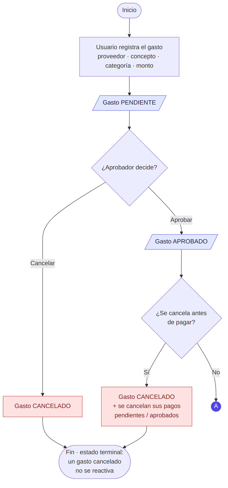
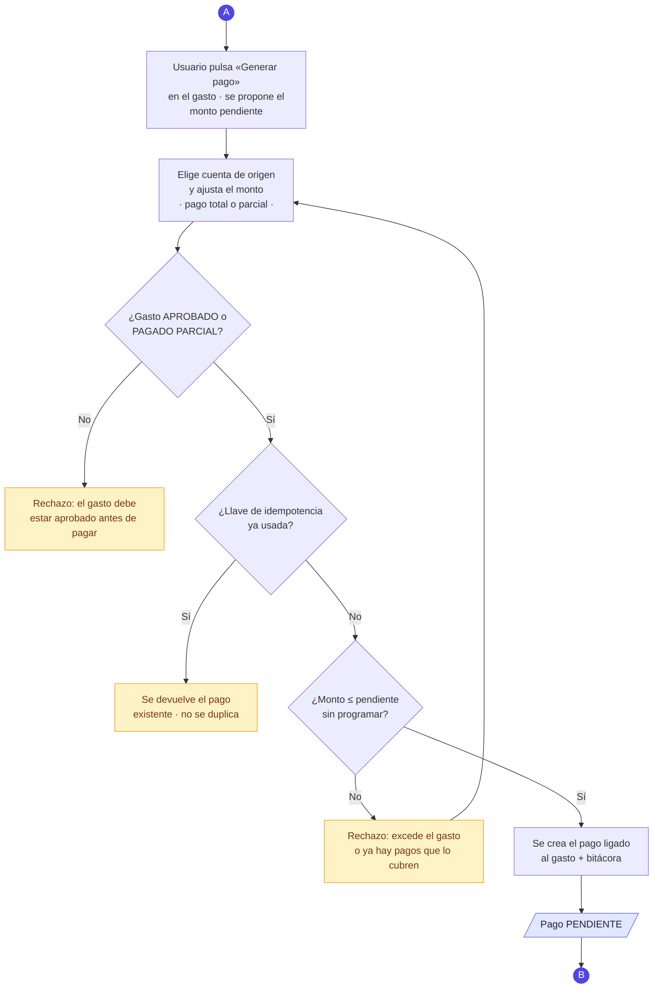
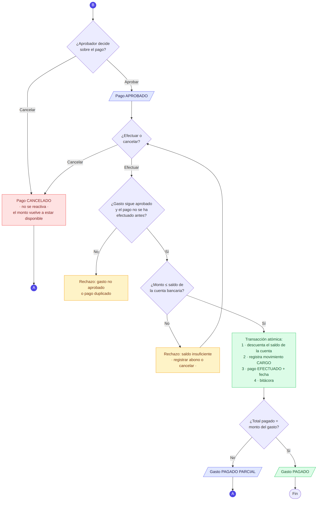
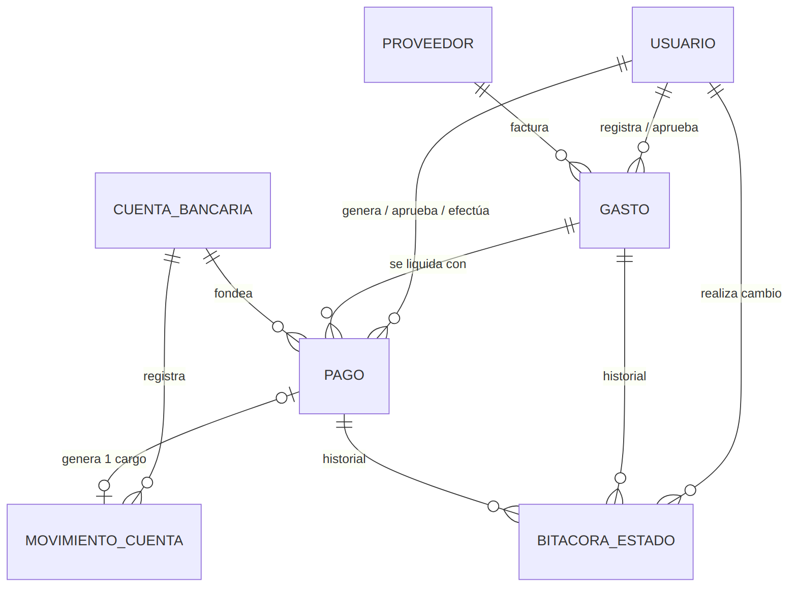
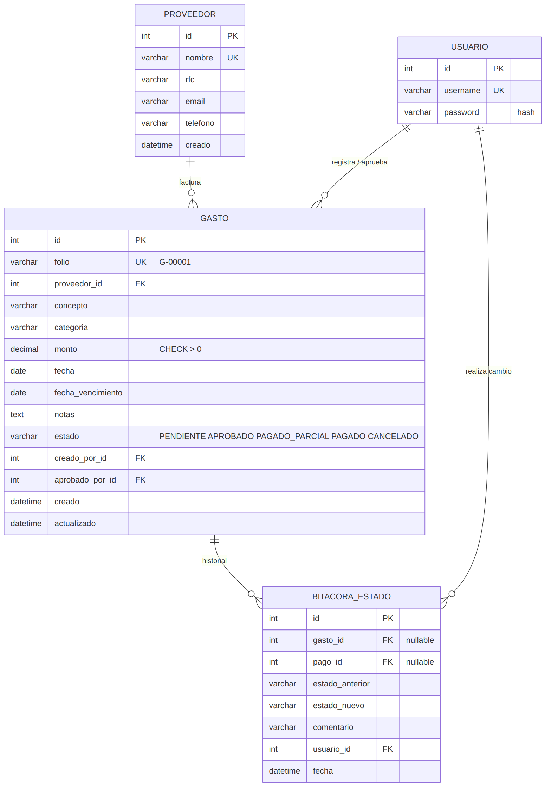
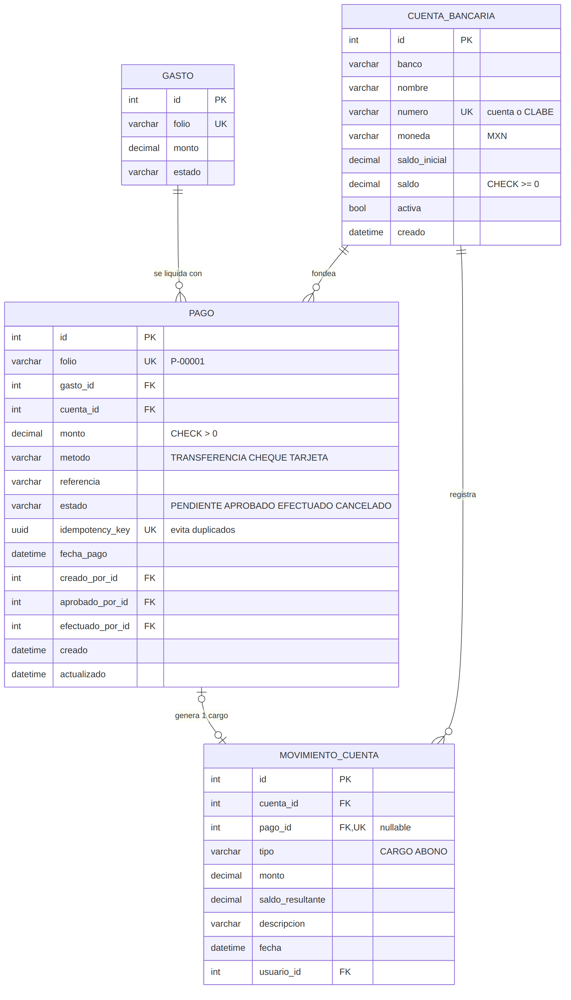

# 1. Acceso a la aplicación

| Dato | Valor |
|---|---|
| URL de la aplicación | **https://\<TU-SERVICIO\>.onrender.com** |
| Usuario | **\<USUARIO\>** |
| Contraseña | **\<CONTRASEÑA\>** |
| Documentación interactiva de la API (Swagger) | https://\<TU-SERVICIO\>.onrender.com/api/docs/ |
| API REST (URL base) | https://\<TU-SERVICIO\>.onrender.com/api/ |

La aplicación está desplegada en Render y se usa directamente desde el navegador; no requiere instalar nada.

> Nota: el plan gratuito de Render suspende el servicio tras 15 minutos sin uso; la primera carga después de eso puede tardar de 30 a 60 segundos.

## 1.1 Cómo ingresar a la aplicación

1. Abra en el navegador (Chrome, Firefox, Edge o Safari, en computadora o celular) la URL de la aplicación indicada en la tabla anterior.
2. Si el servicio estaba inactivo, espere entre 30 y 60 segundos mientras se reactiva; después aparece la pantalla **Inicia sesión**.
3. Escriba el **Usuario** y la **Contraseña** de la tabla anterior (distinguen mayúsculas y minúsculas) y pulse **Entrar**.
4. Se abrirá el **Tablero**. Desde el menú lateral se accede a *Gastos*, *Pagos*, *Cuentas bancarias* y *Proveedores*. En celular, el menú se abre con el botón ☰ de la esquina superior izquierda.
5. Para cerrar sesión, pulse **Cerrar sesión** en la parte inferior del menú lateral. El botón con el ícono de luna/sol cambia entre modo claro y oscuro.

Si aparece el mensaje *"Usuario o contraseña incorrectos"*, verifique que no haya espacios al inicio o al final y que el bloqueo de mayúsculas esté desactivado.

**Acceso a la API REST:** se usan las mismas credenciales.

- **Desde el navegador:** en el menú lateral pulse **API REST · docs** (Swagger), luego **Authorize**, escriba usuario y contraseña, pulse **Authorize** y **Close**. Después, en cualquier endpoint, pulse **Try it out** y **Execute**.
- **Desde una terminal:** `curl -u USUARIO:CONTRASEÑA https://<TU-SERVICIO>.onrender.com/api/gastos/`

## 1.2 Lenguajes y tecnologías utilizadas

| Capa | Tecnología |
|---|---|
| Lenguaje back-end | **Python 3.12** |
| Framework web | **Django 5.1** |
| API REST | **Django REST Framework** + drf-spectacular (OpenAPI 3 / Swagger) |
| Base de datos | **PostgreSQL** (producción), SQLite (desarrollo) — **SQL** mediante el ORM de Django |
| Front-end | **HTML5**, **CSS3**, **JavaScript**; Bootstrap 5 (front-end pre-hecho), Chart.js (gráficos), tipografía Inter |
| Servidor / despliegue | Gunicorn, WhiteNoise, Render (Blueprint `render.yaml`) |
| Diagramas | Mermaid |

## 1.3 Funcionalidades

- Tablero con indicadores (gastos vigentes, por pagar, pagado en el mes, saldo en cuentas) y 4 gráficos.
- Gastos: alta, edición (mientras está pendiente), filtros, aprobación, cancelación y botón **Generar pago** ligado al gasto.
- Pagos: aprobación, cancelación y **efectuar pago** (descuenta el saldo de la cuenta).
- Cuentas bancarias: saldo, abonos, historial de movimientos y gráfico de evolución del saldo.
- Proveedores: catálogo con gasto acumulado.
- Bitácora de cambios de estado en cada gasto y pago.
- API REST de solo lectura (GET) con autenticación básica.
- Inicio de sesión obligatorio, modo claro/oscuro y diseño adaptable a móvil.

# 2. Diagrama de flujo del proceso

El proceso completo (gastos y pagos) se presenta como **un solo diagrama dividido en 3 partes** para que sea legible. Las partes se enlazan con conectores:

| Símbolo | Significado |
|---|---|
| **(A)** círculo índigo | Conector: continúa en la Parte 2 (generar pago desde el gasto) |
| **(B)** círculo índigo | Conector: continúa en la Parte 3 (aprobar y efectuar el pago) |
| Rombo | Decisión o validación de una regla de negocio |
| Paralelogramo índigo | Estado del gasto o del pago |
| Rectángulo amarillo | Rechazo por regla de negocio (la operación no se realiza) |
| Rectángulo rojo | Cancelación (estado terminal, no se reactiva) |
| Rectángulo verde | Operación exitosa |

## 2.1 Parte 1 — Registro y aprobación del gasto

{height=18cm}

## 2.2 Parte 2 — Generar pago desde el gasto (botón)

{height=19cm}

## 2.3 Parte 3 — Aprobar y efectuar el pago

{height=19cm}

## 2.4 Reglas de negocio implementadas

| Regla | Cómo se garantiza |
|---|---|
| Gasto debe estar aprobado antes de pagar | Sólo se puede generar un pago si el gasto está APROBADO o PAGADO PARCIAL; al efectuar el pago se valida de nuevo. |
| Pago no puede exceder saldo | Al efectuar se bloquea la fila de la cuenta (`SELECT … FOR UPDATE`) y se valida `monto ≤ saldo`. El pago tampoco puede exceder lo pendiente del gasto. La base de datos tiene `CHECK saldo >= 0`. |
| Pagos parciales permitidos | El botón *Generar pago* propone el saldo pendiente pero acepta un monto menor. El gasto pasa a PAGADO PARCIAL y, al completar el total, a PAGADO. |
| Evitar pagos duplicados | (1) Llave de idempotencia UUID única por formulario: un doble envío devuelve el mismo pago. (2) No se pueden programar pagos por más del total del gasto. (3) Un pago efectuado no puede volver a efectuarse (bloqueo de fila + validación de estado). (4) `movimiento_cuenta.pago_id` es único: un pago genera un solo cargo. (5) Los botones se deshabilitan tras el primer clic. |
| Gastos cancelados no se reactivan | CANCELADO es un estado terminal para gastos y pagos. Cancelar un gasto cancela sus pagos pendientes/aprobados; no se puede cancelar un gasto con pagos ya efectuados. |

Todas las operaciones se ejecutan en transacciones atómicas y quedan registradas en la bitácora de estados (quién, cuándo, de qué estado a cuál).

# 3. Diagrama de base de datos

El modelo relacional se presenta como **un solo diagrama entidad-relación dividido en 3 partes**: la vista general muestra todas las tablas y sus relaciones; las partes 1 y 2 muestran los campos de cada tabla.

Notación: `PK` llave primaria · `FK` llave foránea · `UK` valor único · `||--o{` uno a muchos · `|o--o|` uno a cero-o-uno.

## 3.1 Vista general (tablas y relaciones)

{width=16cm}

## 3.2 Parte 1 — Proveedores, gastos y bitácora

{height=19cm}

## 3.3 Parte 2 — Pagos, cuentas bancarias y movimientos

{height=19cm}

## 3.4 Diccionario de datos

**`auth_user` (USUARIO)** — usuarios que inician sesión (tabla estándar de Django).

| Campo | Tipo | Descripción |
|------|------|--------|
| id | int PK | Identificador |
| username | varchar UK | Nombre de usuario |
| password | varchar | Contraseña cifrada (hash PBKDF2) |

**`finanzas_proveedor`** — catálogo de proveedores.

| Campo | Tipo | Descripción |
|------|------|--------|
| id | int PK | Identificador |
| nombre | varchar(150) UK | Razón social |
| rfc | varchar(13) | RFC |
| email, telefono | varchar | Contacto |
| creado | datetime | Fecha de alta |

**`finanzas_gasto`** — gastos de la empresa.

| Campo | Tipo | Descripción |
|------|------|--------|
| id | int PK | Identificador |
| folio | varchar UK | Folio automático `G-00001` |
| proveedor_id | int FK → proveedor | Proveedor que factura |
| concepto | varchar(200) | Descripción |
| categoria | varchar | OPERACION, NOMINA, SERVICIOS, MATERIALES, VIATICOS, TECNOLOGIA, IMPUESTOS, OTROS |
| monto | decimal(14,2) | Importe total, `CHECK > 0` |
| fecha, fecha_vencimiento | date | Fecha del gasto y de vencimiento |
| notas | text | Observaciones |
| estado | varchar | PENDIENTE, APROBADO, PAGADO_PARCIAL, PAGADO, CANCELADO |
| creado_por_id, aprobado_por_id | int FK → usuario | Quién registró / aprobó |
| creado, actualizado | datetime | Auditoría |

**`finanzas_pago`** — pagos ligados a un gasto.

| Campo | Tipo | Descripción |
|------|------|--------|
| id | int PK | Identificador |
| folio | varchar UK | Folio automático `P-00001` |
| gasto_id | int FK → gasto | Gasto que liquida |
| cuenta_id | int FK → cuenta_bancaria | Cuenta de origen |
| monto | decimal(14,2) | Importe, `CHECK > 0` (puede ser parcial) |
| metodo | varchar | TRANSFERENCIA, CHEQUE, TARJETA |
| referencia | varchar | Referencia bancaria |
| estado | varchar | PENDIENTE, APROBADO, EFECTUADO, CANCELADO |
| idempotency_key | uuid UK | Evita pagos duplicados por doble envío |
| fecha_pago | datetime | Momento en que se efectuó |
| creado_por_id, aprobado_por_id, efectuado_por_id | int FK → usuario | Responsables |
| creado, actualizado | datetime | Auditoría |

**`finanzas_cuentabancaria`** — cuentas bancarias y su saldo.

| Campo | Tipo | Descripción |
|------|------|--------|
| id | int PK | Identificador |
| banco, nombre | varchar | Banco y alias |
| numero | varchar(20) UK | Número de cuenta o CLABE |
| moneda | varchar(3) | MXN (única moneda admitida) |
| saldo_inicial | decimal(14,2) | Saldo con el que se dio de alta |
| saldo | decimal(14,2) | Saldo actual, `CHECK >= 0` |
| activa | bool | Sólo cuentas activas pueden pagar |

**`finanzas_movimientocuenta`** — libro de movimientos que explica el saldo.

| Campo | Tipo | Descripción |
|------|------|--------|
| id | int PK | Identificador |
| cuenta_id | int FK → cuenta_bancaria | Cuenta afectada |
| pago_id | int FK UK, nulo | Pago que originó el cargo (único: un cargo por pago) |
| tipo | varchar | CARGO (salida) o ABONO (entrada) |
| monto | decimal(14,2) | Importe |
| saldo_resultante | decimal(14,2) | Saldo de la cuenta después del movimiento |
| descripcion | varchar | Detalle |
| fecha | datetime | Fecha del movimiento |
| usuario_id | int FK → usuario | Quién lo realizó |

**`finanzas_bitacoraestado`** — auditoría de cambios de estado.

| Campo | Tipo | Descripción |
|------|------|--------|
| id | int PK | Identificador |
| gasto_id / pago_id | int FK, nulo | Registro afectado (uno de los dos) |
| estado_anterior, estado_nuevo | varchar | Transición realizada |
| comentario | varchar | Motivo o descripción |
| usuario_id | int FK → usuario | Quién hizo el cambio |
| fecha | datetime | Cuándo |

# 4. Video de la aplicación

Enlace: **\<ENLACE A GOOGLE DRIVE\>**

Funcionalidades mostradas en el video:

1. Inicio de sesión.
2. Tablero: indicadores y gráficos.
3. Alta de proveedor y de cuenta bancaria; abono a una cuenta.
4. Registro de un gasto, aprobación y cancelación (y que un gasto cancelado no se reactiva).
5. Botón **Generar pago**: pago total y pago parcial.
6. Aprobación, cancelación y ejecución de pagos; actualización del saldo de la cuenta y del estado del gasto.
7. Validaciones: pago de un gasto no aprobado, saldo insuficiente e intento de pago duplicado.
8. Historial de movimientos y bitácora.
9. API REST: Swagger y consultas con usuario y contraseña.

# 5. Documentación de la API REST

## 5.1 Información general

| Concepto | Valor |
|---|---|
| URL base | `https://<TU-SERVICIO>.onrender.com/api/` |
| Métodos permitidos | Sólo `GET` (API de solo lectura) |
| Autenticación | HTTP Basic: el mismo usuario y contraseña de la aplicación |
| Formato | JSON (UTF-8) |
| Documentación interactiva | `/api/docs/` (Swagger UI) · esquema OpenAPI 3 en `/api/schema/` |
| Montos | Cadenas decimales con 2 decimales, p. ej. `"48000.00"` (evita errores de redondeo) |
| Fechas | `fecha` en formato `YYYY-MM-DD`; fechas con hora en ISO 8601 con zona horaria (`2026-06-17T22:15:49-06:00`) |

### Autenticación

Cada petición debe incluir el encabezado `Authorization: Basic <base64(usuario:contraseña)>`. Con `curl` basta la opción `-u`:

```bash
curl -u USUARIO:CONTRASEÑA https://<TU-SERVICIO>.onrender.com/api/gastos/
```

Desde el navegador, si ya se inició sesión en la aplicación, la API también acepta la sesión activa.

### Paginación

Los listados devuelven 20 elementos por página con esta estructura:

```json
{
  "count": 20,
  "next": "https://<TU-SERVICIO>.onrender.com/api/gastos/?page=2",
  "previous": null,
  "results": [ ... ]
}
```

Use `?page=N` para navegar. Los filtros se pueden combinar con la paginación.

## 5.2 Resumen de endpoints

| # | Método | Endpoint | Descripción |
|--|----|--------------|-----------|
| 1 | GET | `/api/gastos/` | Lista de gastos (con filtros) |
| 2 | GET | `/api/gastos/{id}/` | Detalle de un gasto con sus pagos y bitácora |
| 3 | GET | `/api/pagos/` | Lista de pagos (con filtros) |
| 4 | GET | `/api/pagos/{id}/` | Detalle de un pago con su bitácora |
| 5 | GET | `/api/cuentas/` | Cuentas bancarias y saldos |
| 6 | GET | `/api/cuentas/{id}/` | Detalle de una cuenta |
| 7 | GET | `/api/cuentas/{id}/movimientos/` | Movimientos de una cuenta |
| 8 | GET | `/api/movimientos/` | Movimientos de todas las cuentas |
| 9 | GET | `/api/movimientos/{id}/` | Detalle de un movimiento |
| 10 | GET | `/api/proveedores/` | Proveedores |
| 11 | GET | `/api/proveedores/{id}/` | Detalle de un proveedor |
| 12 | GET | `/api/resumen/` | Indicadores y datos de los gráficos del tablero |

## 5.3 Gastos

### GET `/api/gastos/`

Lista los gastos, del más reciente al más antiguo.

| Parámetro (query) | Tipo | Descripción |
|-----|---|----------|
| `estado` | texto | `PENDIENTE`, `APROBADO`, `PAGADO_PARCIAL`, `PAGADO`, `CANCELADO` |
| `categoria` | texto | `OPERACION`, `NOMINA`, `SERVICIOS`, `MATERIALES`, `VIATICOS`, `TECNOLOGIA`, `IMPUESTOS`, `OTROS` |
| `proveedor` | entero | ID del proveedor |
| `desde` | fecha | Fecha inicial (`YYYY-MM-DD`) |
| `hasta` | fecha | Fecha final (`YYYY-MM-DD`) |
| `page` | entero | Número de página |

```bash
curl -u USUARIO:CONTRASEÑA "https://<TU-SERVICIO>.onrender.com/api/gastos/?estado=PAGADO_PARCIAL"
```

Cada elemento de `results` tiene los mismos campos que el detalle, sin `pagos` ni `bitacora`.

### GET `/api/gastos/{id}/`

Detalle de un gasto con sus pagos y su historial de estados. Respuesta `200 OK`:

```json
{
  "id": 4,
  "folio": "G-00004",
  "proveedor": "Soluciones TI Norte",
  "proveedor_id": 4,
  "concepto": "Licencias de software anuales",
  "categoria": "TECNOLOGIA",
  "monto": "48000.00",
  "monto_pagado": "24000.00",
  "saldo_pendiente": "24000.00",
  "fecha": "2026-06-12",
  "fecha_vencimiento": "2026-07-12",
  "estado": "PAGADO_PARCIAL",
  "notas": "",
  "creado_por": "demo",
  "aprobado_por": "demo",
  "creado": "2026-11-06T22:15:49-06:00",
  "actualizado": "2026-11-06T22:15:49-06:00",
  "pagos": [
    {"id": 4, "folio": "P-00004", "monto": "24000.00", "estado": "EFECTUADO",
     "cuenta": "BBVA - Operativa principal (…7890)",
     "fecha_pago": "2026-06-17T22:15:49-06:00"}
  ],
  "bitacora": [
    {"estado_anterior": "APROBADO", "estado_nuevo": "PAGADO_PARCIAL",
     "comentario": "Actualizado por pago P-00004", "usuario": "demo",
     "fecha": "2026-11-06T22:15:49-06:00"},
    {"estado_anterior": "PENDIENTE", "estado_nuevo": "APROBADO",
     "comentario": "Gasto aprobado", "usuario": "demo",
     "fecha": "2026-11-06T22:15:49-06:00"}
  ]
}
```

| Campo | Descripción |
|---|---|
| `monto_pagado` | Suma de los pagos EFECTUADOS |
| `saldo_pendiente` | `monto − monto_pagado` |
| `pagos` | Pagos ligados al gasto (todos los estados) |
| `bitacora` | Cambios de estado, del más reciente al más antiguo |

## 5.4 Pagos

### GET `/api/pagos/`

| Parámetro (query) | Tipo | Descripción |
|-----|---|----------|
| `estado` | texto | `PENDIENTE`, `APROBADO`, `EFECTUADO`, `CANCELADO` |
| `gasto` | entero | ID del gasto |
| `cuenta` | entero | ID de la cuenta bancaria |
| `page` | entero | Número de página |

```bash
curl -u USUARIO:CONTRASEÑA "https://<TU-SERVICIO>.onrender.com/api/pagos/?gasto=4"
```

### GET `/api/pagos/{id}/`

Respuesta `200 OK`:

```json
{
  "id": 4,
  "folio": "P-00004",
  "gasto": "G-00004",
  "gasto_id": 4,
  "cuenta": "BBVA - Operativa principal (…7890)",
  "cuenta_id": 1,
  "monto": "24000.00",
  "metodo": "TRANSFERENCIA",
  "referencia": "REF1003",
  "estado": "EFECTUADO",
  "fecha_pago": "2026-06-17T22:15:49-06:00",
  "creado_por": "demo",
  "aprobado_por": "demo",
  "efectuado_por": "demo",
  "creado": "2026-11-06T22:15:49-06:00",
  "actualizado": "2026-11-06T22:15:49-06:00",
  "bitacora": [
    {"estado_anterior": "APROBADO", "estado_nuevo": "EFECTUADO",
     "comentario": "Pago efectuado desde Operativa principal", "usuario": "demo",
     "fecha": "2026-11-06T22:15:49-06:00"}
  ]
}
```

En el listado (`/api/pagos/`) cada elemento tiene los mismos campos, sin `bitacora`.

## 5.5 Cuentas bancarias y movimientos

### GET `/api/cuentas/` y `/api/cuentas/{id}/`

```json
{
  "count": 3, "next": null, "previous": null,
  "results": [
    {"id": 1, "banco": "BBVA", "nombre": "Operativa principal",
     "numero": "012180001234567890", "moneda": "MXN",
     "saldo_inicial": "250000.00", "saldo": "213769.50", "activa": true,
     "creado": "2026-11-06T22:15:49-06:00"}
  ]
}
```

### GET `/api/cuentas/{id}/movimientos/` y `/api/movimientos/`

`/api/movimientos/` acepta el filtro `tipo` (`CARGO` o `ABONO`).

```json
{
  "count": 4, "next": null, "previous": null,
  "results": [
    {"id": 13, "cuenta": "BBVA - Operativa principal (…7890)", "tipo": "CARGO",
     "monto": "8750.00", "saldo_resultante": "213769.50",
     "descripcion": "Pago P-00012 - G-00016 Transportes Rápidos del Bajío",
     "pago": "P-00012", "fecha": "2026-10-09T22:15:49-06:00"}
  ]
}
```

`pago` es `null` en los abonos (depósitos y saldo inicial).

## 5.6 Proveedores

### GET `/api/proveedores/` y `/api/proveedores/{id}/`

```json
{"id": 3, "nombre": "CFE Suministrador", "rfc": "CSS160330CP7",
 "email": "facturacion@cfe.example", "telefono": "",
 "creado": "2026-11-06T22:15:49-06:00"}
```

## 5.7 Resumen del tablero

### GET `/api/resumen/`

Devuelve los indicadores y los datos de los gráficos del tablero (montos como números).

```json
{
  "total_gastos": 232575.25,
  "total_pagado": 112990.25,
  "por_pagar": 119585.0,
  "pagado_mes": 5990.0,
  "saldo_cuentas": 317009.75,
  "gastos_pendientes_aprobacion": 0,
  "pagos_por_aprobar": 0,
  "pagos_por_efectuar": 2,
  "gastos_por_estado": [{"etiqueta": "Aprobado", "cantidad": 6, "monto": 73420.0}],
  "gastos_por_categoria": [{"categoria": "Tecnología", "monto": 112800.0}],
  "gastos_vs_pagos_por_mes": [{"mes": "2026-06", "gastos": 85550.0, "pagos": 52050.0}],
  "saldo_por_cuenta": [{"id": 1, "cuenta": "Operativa principal", "banco": "BBVA", "saldo": 213769.5}]
}
```

(Las listas se muestran recortadas a un elemento.)

## 5.8 Códigos de respuesta y errores

| Código | Cuándo ocurre | Cuerpo de ejemplo |
|------|-------|-----------|
| 200 OK | Consulta exitosa | Datos solicitados |
| 400 Bad Request | Filtro con valor inválido (ID no numérico o fecha que no es `YYYY-MM-DD`) | `{"desde": ["Fecha inválida; use el formato AAAA-MM-DD."]}` |
| 401 Unauthorized | Sin credenciales o credenciales inválidas | `{"detail": "Las credenciales de autenticación no se proveyeron."}` |
| 404 Not Found | El ID no existe | `{"detail": "No Gasto matches the given query."}` |
| 405 Method Not Allowed | Se usó POST, PUT, PATCH o DELETE | `{"detail": "Método \"POST\" no permitido."}` |
